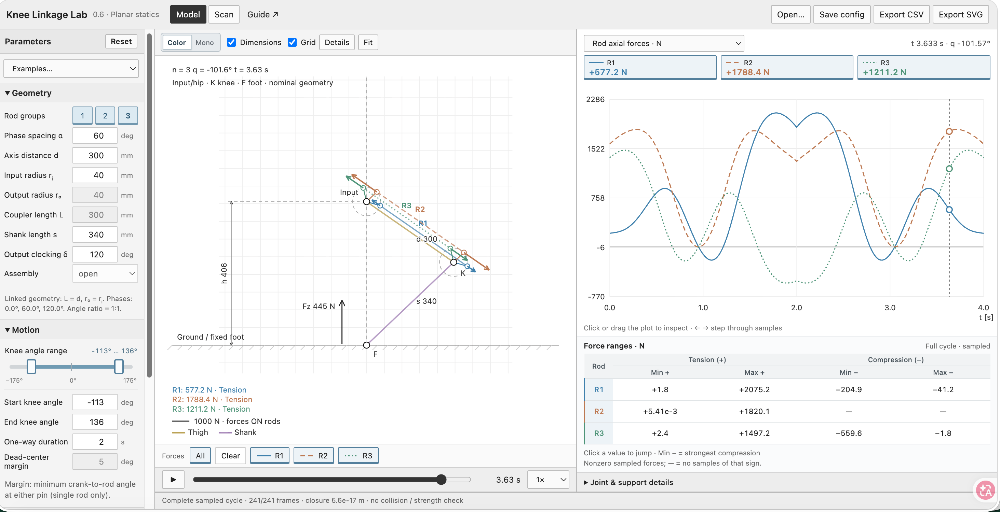

# Knee Linkage Lab

A local, interactive Python workbench for exploring planar knee transmissions with parallel rod groups or chain drives. Adjust geometry, phase spacing, motion range and loading; inspect signed rod forces, force arrows, input torque and support reactions throughout a cycle.

Prepared by Peiyu Wang. UI / chain module v0.9; rod solver v0.4.0.



## Chain module (v0.9)

Open **Chain** or visit `http://127.0.0.1:8786/chain.html`. Compare four catalog products or a custom chain, with integer teeth and even link-count ranges. Output teeth now follow the ratio limit directly; the minimum is fixed at 1 and ratio_max cannot exceed 2. Estimated input tooth-tip diameter defaults to a 100 mm limit. For the current compact knee study, set this limit to 70 mm. This is a configurable package constraint, not a change to the catalog dimensions.

Choose a single outside idler on span B or a mirrored pair on A/B. The tool searches a longitudinal grid and solves inward travel to close the circular pitch path for each even N, rejecting travel/wrap/interference failures. Shaft and idler reactions follow the solved tangent directions. This is a fixed-idler model, without spring tensioner dynamics or discrete tooth engagement.

**Chain data** displays pitch, roller/bush diameter, inner-plate clear spacing, plate height, overall pin width, allowable load and manufacturer links. Sprocket tooth width must account for clearance within the inner spacing. Missing allowable load remains unrated.

The modules keep independent configurations. **Use current linkage task** copies shared task inputs. The browser Guide and [chain guide](static/chain-guide.html) explain formulas, limits and the route solver. The Python test suite includes independent force/moment and idler virtual-work checks.

## What it helps answer

- Which rods carry tension or compression, and at which poses?
- How do crank radius and phase layout change peak rod loads and support reactions?
- Does the requested motion cross a transmission dead point?
- Which configurations satisfy user-defined limits within a finite parameter grid?

The three-group 60° and 120° layouts provide an instructive result: identical peak absolute rod loads can coexist with very different knee-axis reactions and compression demands. See the [initial findings and definitions](docs/Initial-findings.en.md).

## Run locally

Python 3.9 or later; no third-party Python packages are required.

```sh
git clone https://github.com/peiyuwang1018/knee-linkage-lab.git
cd knee-linkage-lab
```

```sh
python3 launcher.py
```

On Windows, use `py launcher.py` if Python is installed through the Windows launcher. The application opens at `http://127.0.0.1:8786`. The Python server runs on the same computer as the browser. To run in the foreground instead:

```sh
python3 server.py
```

Then open the address above; Ctrl+C stops the foreground server. If the port is occupied, use `--port 8787`.

Use the group-count cells and dual angle handles to adjust the model. Select any combination of R1/R2/R3 to overlay forces; All selects every rod, Clear clears overlays. Phase spacing and clocking also have sliders; Mirror about 0° uses one half-range value. One-way plots retrace on return, and Round trip shows the full cycle. The torque plot includes rated module torque, extra reduction and efficiency, with green capacity intervals and coverage measured over the requested knee-angle range. Save/Open config preserves mechanical parameters and these display/analysis settings. Export CSV saves time histories; Export SVG saves the current drawing.

## Reproduce and inspect

```sh
python3 -m unittest discover -s tests -v
python3 benchmark.py
python3 cli.py cycle --config examples/default.json --out output/my-cycle
python3 cli.py scan --config examples/default.json --out output/my-scan
```

`benchmark.py` writes controlled comparisons, stiffness sensitivity and the default Pareto front to `output/phase-benchmark/`. Outputs are model predictions, not measurements. The browser's Guide explains assumptions and signs. See [Model and parameters](docs/Model.md) for the rod model and [Chain guide](static/chain-guide.html) for chain routing and loading.

## Model scope

The input and output discs share multiple compatible parallelogram paths when n ≥ 2. Their ideal angular and torque ratio is 1:1. Multi-rod load sharing assumes small axial compliance, assigned stiffnesses, rigid discs, zero preload and zero clearance. The foot is fixed and the hip moves vertically above it. Loading is either a prescribed vertical force or a point-mass approximation using hip acceleration.

Link masses, full robot balance, 3D packaging, collision, buckling, joint clearances, bearing-pair loads and motor thermal limits are not modeled. `Knee support` is a resultant axis reaction in newtons; it is not knee torque or an individual bearing's load. The Linkage Pareto label minimizes only peak absolute rod force and crank radius, within the sampled feasible grid.

GitHub can host this source repository for download. The current application is not a standalone GitHub Pages site: its calculations use the local Python server. A browser-only runtime or a separately hosted backend would be a distinct deployment step.

## UI analysis checks

The Python solver test suite above remains dependency-free. The optional display-analysis tests use Node.js (no npm packages):

```sh
node --test tests/test_analysis.cjs
```

The motor-capacity overlay is a constant-torque comparison. Coverage interpolates valid sample segments, requires both travel directions, and includes excluded/invalid angles in the requested-range denominator. It is not a speed, thermal or strength qualification.
