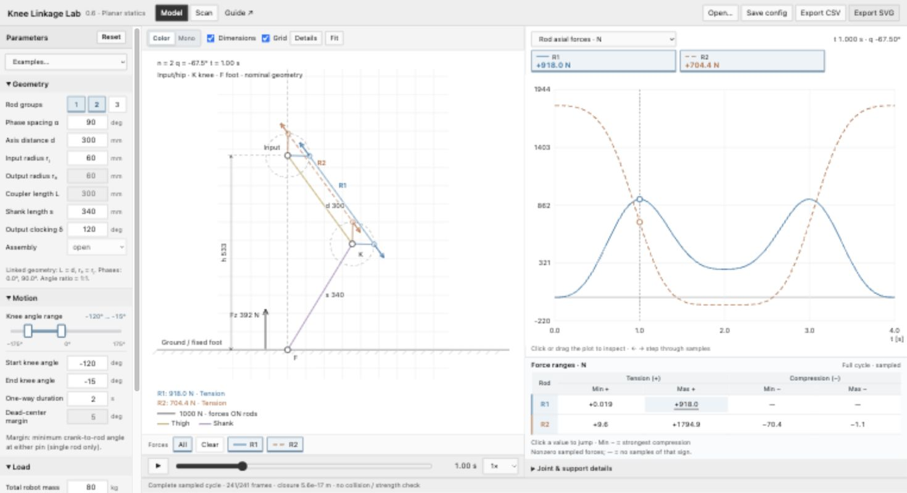

# Knee Linkage Lab

A local, interactive Python workbench for exploring planar knee transmissions with one to three parallel rod groups. Adjust geometry, phase spacing, motion range and loading; inspect signed rod forces, force arrows, input torque and support reactions throughout a cycle.

Prepared by Peiyu Wang. UI v0.6; analytical solver v0.4.0.



## What it helps answer

- Which rods carry tension or compression, and at which poses?
- How do crank radius and phase layout change peak rod loads and support reactions?
- Does the requested motion cross a transmission dead point?
- Which configurations satisfy user-defined limits within a finite parameter grid?

The three-group 60° and 120° layouts provide an instructive result: identical peak absolute rod loads can coexist with very different knee-axis reactions and compression demands. See the [initial findings and definitions](docs/Initial-findings.en.md).

## Run locally

Python 3.9 or later; no third-party Python packages are required. Download this repository or clone it, then open a terminal in the project folder.

```sh
git clone https://github.com/peiyuwang1018/knee-linkage-lab.git
cd knee-linkage-lab
```

```sh
python3 launcher.py
```

On Windows, use `py launcher.py` if Python is installed through the Windows launcher. The application opens at `http://127.0.0.1:8786`. The Python server runs on the same computer as the browser. To run in the foreground instead:

```sh
python3 server.py
```

Then open the address above; Ctrl+C stops the foreground server. If the port is occupied, use `--port 8787`.

Use the group-count cells and dual angle handles to adjust the model. Select any combination of R1/R2/R3 to overlay forces; All selects every rod, Clear clears overlays. Save/Open config preserves parameters. Export CSV saves time histories; Export SVG saves the current drawing.

## Reproduce and inspect

```sh
python3 -m unittest discover -s tests -v
python3 benchmark.py
python3 cli.py cycle --config examples/default.json --out output/my-cycle
python3 cli.py scan --config examples/default.json --out output/my-scan
```

`benchmark.py` writes controlled comparisons, stiffness sensitivity and the default Pareto front to `output/phase-benchmark/`. Outputs are model predictions, not measurements. The browser's Guide explains assumptions and signs; see [Model and parameters](docs/Model.md) for a compact reference.

## Model scope

The input and output discs share multiple compatible parallelogram paths when n ≥ 2. Their ideal angular and torque ratio is 1:1. Multi-rod load sharing assumes small axial compliance, assigned stiffnesses, rigid discs, zero preload and zero clearance. The foot is fixed and the hip moves vertically above it. Loading is either a prescribed vertical force or a point-mass approximation using hip acceleration.

Link masses, full robot balance, 3D packaging, collision, buckling, joint clearances, bearing-pair loads and motor thermal limits are not modeled. `Knee support` is a resultant axis reaction in newtons; it is not knee torque or an individual bearing's load. The Pareto label currently minimizes only peak absolute rod force and crank radius, within the sampled feasible grid.

GitHub can host this source repository for download. The current application is not a standalone GitHub Pages site: its calculations use the local Python server. A browser-only runtime or a separately hosted backend would be a distinct deployment step.
